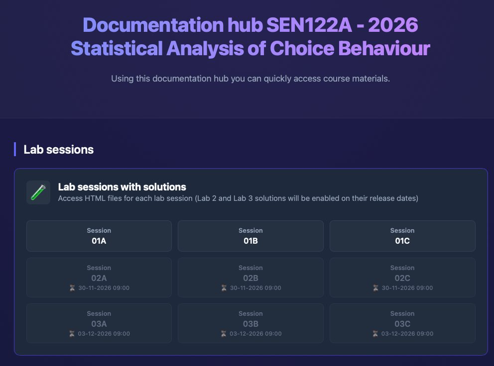

# Documentation hub SEN122A - 2026  Statistical Analysis of Choice Behaviour

To access the documentation hub: 
- Download the repo to your own computer.
- Unzip the file.
- Double-click on the file named `index.html` to open it in your web browser. From here, you can navigate through the files; see the screenshot below. 

### Lab Session publication dates

The lab sessions and answers will be available on the following dates:

| Week | Lab session | Publication date Lab session | Publication date Answers |
|:----:|:-----------:|:--------------------------------:|:------------------------------------------:|
| 47 | Lab 1 | ✅ [Available](https://github.com/SEN1221TUD/SEN122A_2026/tree/main/Lab_sessions/Lab_session_01) | ✅ [Available](https://github.com/SEN1221TUD/SEN122A_2026/tree/main/Lab_sessions/Lab_session_01) |
| 48 | Lab 2 | ✅ [Available](https://github.com/SEN1221TUD/SEN122A_2026/tree/main/Lab_sessions/Lab_session_02) | ⏳ 30-11-2026 09:00 |
| 49 | Lab 3 | ⏳ 30-11-2026 09:00 | ⏳ 03-12-2026 09:00 |

> **Note:** In this documentation hub (`index.html`), only the solutions for **Lab 1** (`Lab_01A`, `Lab_01B`, and `Lab_01C`) are currently enabled. Solutions for **Lab 2** and **Lab 3** will be enabled in the documentation hub on the dates listed above.
